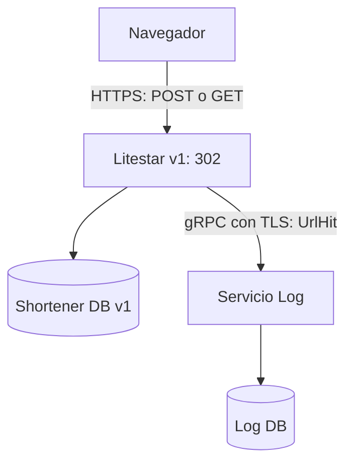
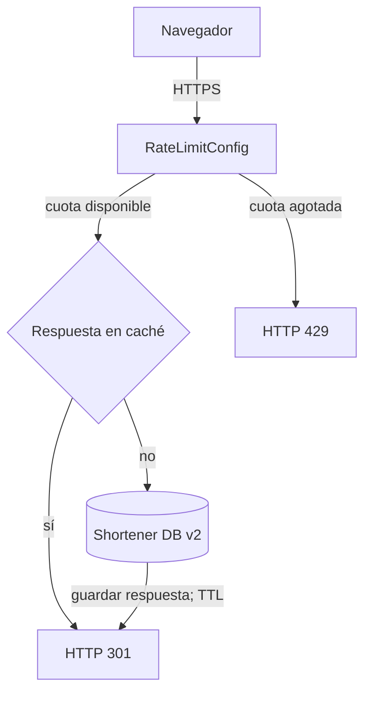

# Tarea 2 - INF326 - Arquitectura de Software

Dos implementaciones ejecutables de un **URL shortener con Litestar**:

- **Arquitectura 1:** HTTPS, redirección **302**, sin almacenamiento de redirecciones en el cliente, y servicio **gRPC/TLS** que registra las visitas en una base de datos propia.
- **Arquitectura 2:** HTTPS, redirección **301**, **rate limiter de Litestar** y **caché de respuestas de Litestar** con TTL.

La discusión solicitada y la respuesta al **bonus de identificadores distribuidos** están en [DISCUSION.md](DISCUSION.md). 

## Integrantes

| Nombre | Rol USM |
| --- | --- |
| Catalina Yañez | 202273010-2 |
| Eduardo Pacheco | 202273014-5 |
| Fernanda Ojeda | 202273025-0 |

Repositorio: https://github.com/feeerog/Tarea2-INF326

Entrega indicada en el enunciado: **domingo 22 de noviembre de 2026, hasta las 23:59**. Se entrega el enlace del repositorio en Aula.

## 1. Ejecución con Docker 

**Requisitos:** Git y Docker con Compose v2. En Windows, iniciar Docker Desktop con contenedores Linux. No se necesita instalar Python en el host para esta opción. Se requiere Internet durante la primera construcción de la imagen.

Abrir una terminal en la carpeta que contiene este README y `compose.yaml`:

```bash
docker compose up --build -d --wait
docker compose ps
```

El primer servicio genera un certificado autofirmado con SAN para localhost y los nombres internos. Los otros servicios esperan ese certificado; v1 también espera a que Log esté disponible.

| Servicio | Dirección / acceso |
| --- | --- |
| Shortener v1 | https://localhost:8443 |
| Shortener v2 | https://localhost:8444 |
| Esquema API v1 | https://localhost:8443/schema |
| Esquema API v2 | https://localhost:8444/schema |
| Log gRPC/TLS | `log-service:50051`, solamente en la red de Compose |

El navegador advertirá que el certificado es autofirmado; se puede aceptar la excepción **para esta demostración local**. Los scripts automatizados confían explícitamente en el certificado y sí verifican su nombre y validez. Las interfaces de documentación pueden necesitar Internet para sus recursos; la API y sus pruebas no necesitan acceder al destino USM.

### Demostración completa

```bash
docker compose exec -T shortener-v1 python scripts/smoke.py --v1 https://shortener-v1:8443 --v2 https://shortener-v2:8444 --cert certs/server.crt
```

Comprueba POST 201, GET 302/301, cabecera `Location`, registro por gRPC, hits de caché, una sola consulta SQL para dos GET de v2 y rechazo **429** al agotar la cuota. No sigue las redirecciones ni visita páginas externas.

**La demostración consume la cuota de v2 para la IP desde donde se ejecuta.** Para repetirla, esperar 60 segundos o reiniciar únicamente v2 con `docker compose restart shortener-v2`. Usar `--skip-rate-limit` si no se desea agotar la cuota (también requiere cuota disponible).

### Inspección de los datos persistentes

```bash
docker compose exec -T shortener-v1 python scripts/inspect_db.py data/shortener_v1.sqlite3
docker compose exec -T shortener-v2 python scripts/inspect_db.py data/shortener_v2.sqlite3
docker compose exec -T log-service python scripts/inspect_db.py data/log.sqlite3 --table hits
docker compose logs --tail 50
```

### Detener

```bash
docker compose down
```

Las tres bases y el certificado se conservan en volúmenes. **`docker compose down -v` borra esos datos** y solo debe usarse cuando se quiera empezar desde cero. Detener/iniciar o reiniciar servicios no reinicia el contador de IDs. La caché y la cuota en memoria sí se reinician.


## 3. Contrato HTTP y ejemplo manual

| Método y ruta | Función | Respuesta |
| --- | --- | --- |
| `POST /urls` | JSON `{"url": "https://..."}`; crea una equivalencia | 201 con `id`, `hash`, `long_url`, `short_url` y `Location` |
| `GET /{hash}` en v1 | Resuelve y envía un evento gRPC | 302, `Location`, `Cache-Control: no-store, max-age=0` |
| `GET /{hash}` en v2 | Aplica cuota, resuelve desde caché o BD | 301, `Location`, `Cache-Control: public, max-age=300` |
| `GET /health` | Comprueba acceso a la base del acortador | 200 si está disponible |
| `GET /stats` | Contadores de demostración de esta instancia | Consultas SQL, caché o resultados gRPC |
| `GET /schema/openapi.json` | Contrato OpenAPI | JSON |

Errores: **400** para URL/cuerpo inválido, **404** para código inexistente, **429** al superar la cuota en v2. El contrato de redirección implementa **GET**; HEAD no está habilitado y devuelve 405. Para ver cabeceras con curl, usar `-i`, no `-I`.

Ejemplo en **Windows PowerShell** (usar `curl.exe`, no el alias `curl`):

```powershell
curl.exe -k -i -X POST https://localhost:8443/urls -H "Content-Type: application/json" --data-binary "@examples/create_url.json"
curl.exe -k -i https://localhost:8443/eRgfR
curl.exe -k -i -X POST https://localhost:8444/urls -H "Content-Type: application/json" --data-binary "@examples/create_url.json"
curl.exe -k -i https://localhost:8444/eRgfR
curl.exe -k https://localhost:8444/stats
```

En Linux/macOS, reemplazar `curl.exe` por `curl`. `-k` omite la validación únicamente para estas llamadas manuales al certificado de desarrollo. En ejecución Python puede reemplazarse por `--cacert certs/server.crt` para validarlo.

**`eRgfR` corresponde únicamente al primer registro de una base nueva.** Si antes se ejecutó la demostración, copiar el `hash`/`short_url` recibido en el POST. En cada arquitectura la primera creación devuelve `id=597652313`, luego `597652314`, etc. Las arquitecturas son alternativas independientes con orígenes y bases separados.

## 4. Diseño y decisiones

### Arquitectura 1



El cliente gRPC reutiliza un canal TLS y tiene un deadline de **0,5 segundos**. El logger confirma después de persistir el evento. Si no recibe confirmación, v1 registra el fallo y mantiene la redirección: es una decisión de disponibilidad con posible pérdida de analítica, explicada en la discusión. `event_id` permite deduplicar un mismo evento; no hay reintentos de aplicación ni cola durable.

### Arquitectura 2



- Cuota predeterminada: **60 peticiones por minuto por IP**, compartida por POST y GET. Incluye respuestas servidas desde caché. `/health`, `/stats` y `/schema` se excluyen para diagnóstico.
- Caché del servidor: `@get(cache=True)`, `ResponseCacheConfig` y `MemoryStore`, **TTL 60 s**. Solo se almacenan respuestas GET 301. Las claves distinguen método, ruta y parámetros de consulta, según Litestar.
- Caché del navegador: se permite mediante 301 y `Cache-Control`, **TTL 300 s**. Es distinta de la copia en memoria del servidor.
- `RateLimit-*` informa cuota, remanente y tiempo hasta reinicio. El límite opera por instancia; no se confía en `X-Forwarded-For` enviado por el cliente.
- Los stores son en memoria, con limpieza de entradas expiradas cada 30 s. Un único worker por servicio. Para varias réplicas se requiere almacenamiento compartido y coordinación del limitador, explicado en la discusión.

### Datos e identificadores

Cada acortador almacena exactamente la información central `<id, hash, long_url>` en `urls`. El identificador se reserva y se inserta dentro de una transacción `BEGIN IMMEDIATE`, utilizando la secuencia persistente de una tabla `AUTOINCREMENT`. El arranque inicializa esa secuencia en `597652312` **solo si todavía no existe**. La primera fila recibe `597652313`.

El `hash` es la codificación Base62 del ID, con alfabeto `0-9A-Za-z`, implementada sin una dependencia adicional. No se trunca. Dos IDs diferentes producen dos códigos diferentes. `PRIMARY KEY` y `UNIQUE(hash)` refuerzan la integridad. Cada nuevo POST válido crea un registro, incluso si repite la misma URL.

Las conexiones SQLite se abren por operación, usan WAL y un timeout de bloqueo de 10 s. Las consultas usan parámetros. La validación acepta URLs HTTP/HTTPS absolutas, sin credenciales ni controles, hasta 8192 caracteres. El acortador **no descarga ni verifica** el contenido del destino.

### Configuración

| Variable | Predeterminado | Efecto |
| --- | --- | --- |
| `BASE_URL` | `https://localhost:8443` o `:8444` | Origen de las URLs devueltas |
| `DB_PATH` | `data/shortener_v1.sqlite3` o `v2` | BD del acortador |
| `LOG_DB_PATH` | `data/log.sqlite3` | BD del logger |
| `HTTP_HOST` | `127.0.0.1` | Dirección de escucha HTTP local |
| `HTTP_PORT` | `8443` o `8444` | Puerto HTTPS |
| `GRPC_BIND` | `127.0.0.1:50051` | Escucha del logger |
| `GRPC_TARGET` | `localhost:50051` | Destino del cliente gRPC |
| `GRPC_TIMEOUT_SECONDS` | `0.5` | Deadline de cada envío |
| `TLS_CERT_FILE` / `TLS_KEY_FILE` | `certs/server.crt` / `certs/server.key` | Certificado y clave |
| `RATE_LIMIT_PER_MINUTE` | `60` | Cuota de v2 |
| `CACHE_TTL_SECONDS` | `60` | Vida de respuesta en caché de v2 |
| `BROWSER_CACHE_TTL_SECONDS` | `300` | `max-age` de la redirección 301 |

Compose carga las tres variables de `.env.example` si se copia como `.env`; los demás valores se editan en `compose.yaml`. En ejecución Python se leen variables del sistema, **no se carga `.env` automáticamente**. Ejemplo PowerShell: `$env:RATE_LIMIT_PER_MINUTE="10"`; Bash: `export RATE_LIMIT_PER_MINUTE=10`. Configurarlas antes de iniciar los procesos.

## 5. Pruebas

```bash
python -m pytest -q
python -m ruff check .
python -m ruff format --check .
```

Con Docker:

```bash
docker compose --profile test run --build --rm tests
```

Las pruebas crean sus propios certificados, bases temporales y puertos; no alteran los datos de la demostración. Incluyen una ejecución real con Uvicorn, HTTPS y gRPC/TLS en procesos separados, concurrencia, persistencia, 301/302, caché, 429 y caída del logger. Ver [docs/PRUEBAS.md](docs/PRUEBAS.md) para el resultado observado y sus límites.

GitHub Actions ejecutará pruebas, revisión de estilo y la demostración de Compose cuando se suba el proyecto. La existencia del workflow no implica que ya haya corrido en GitHub.

## 6. Archivos principales

| Ruta | Responsabilidad |
| --- | --- |
| `shortener/common/` | Base62, configuración, BD y contrato HTTP común |
| `shortener/v1/` | Aplicación 302 y cliente gRPC |
| `shortener/log_service/` | Servidor gRPC y BD de visitas |
| `shortener/v2/` | Aplicación 301, rate limiter y caché |
| `proto/shortener/generated/hits.proto` | Contrato de eventos |
| `shortener/generated/` | Stubs generados y versionados |
| `scripts/` | Certificados, arranque, demostración e inspección |
| `tests/` | Pruebas automáticas |
| `DISCUSION.md` | Trade-offs para la USM y bonus |
| `docs/` | Cumplimiento, pruebas e instrucciones de GitHub |

## 7. Alcance

La solución corresponde a las dos arquitecturas de un nodo del enunciado. No implementa una plataforma productiva de múltiples nodos. El bonus **explica** cómo garantizar unicidad distribuida. Las redirecciones son públicas e inmutables; no hay edición/borrado, cuentas, panel web, moderación de destinos ni medición de personas únicas. `/health` de v1 mide el acortador, no garantiza que Log esté operativo: la analítica tiene su propia salud.

El certificado y las claves se generan en cada despliegue y se excluyen de Git. También se excluyen las bases locales y los entornos virtuales. Se usa el mismo certificado de desarrollo para simplificar la demostración; en producción corresponderían certificados y secretos separados.


